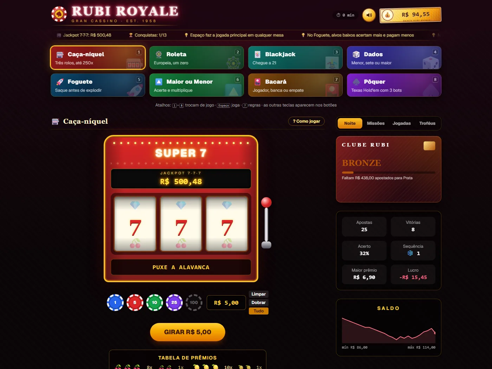
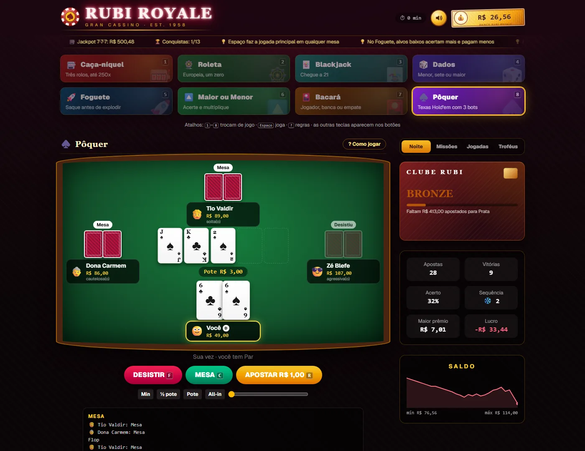
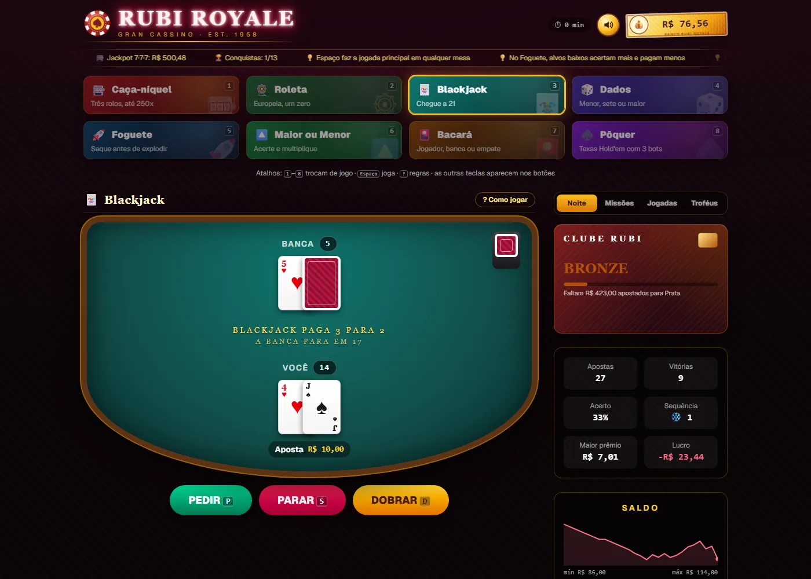
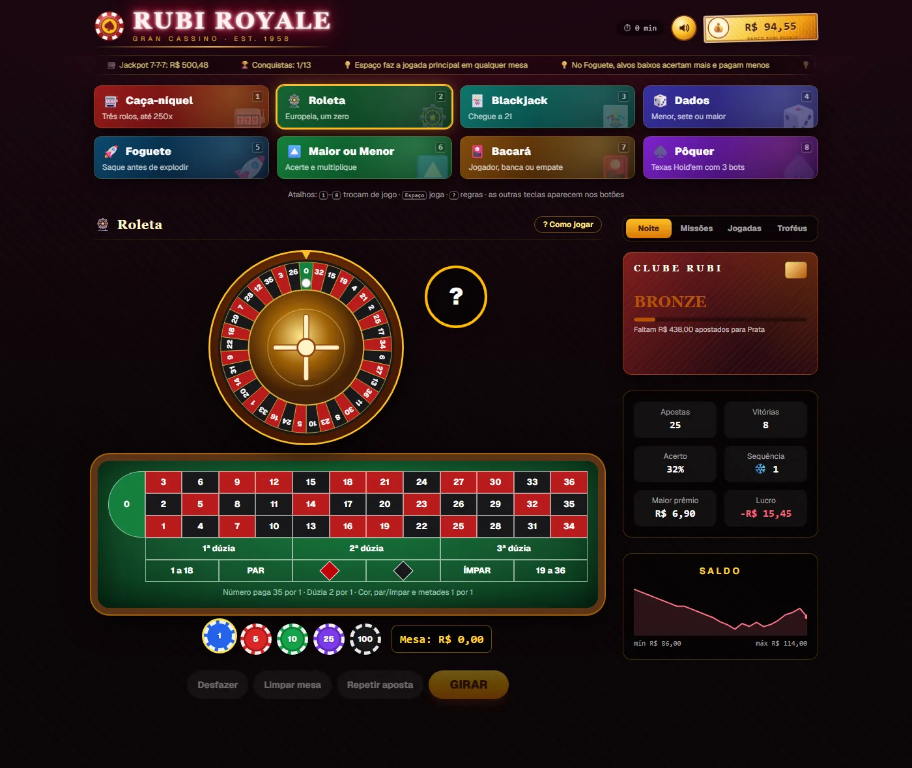
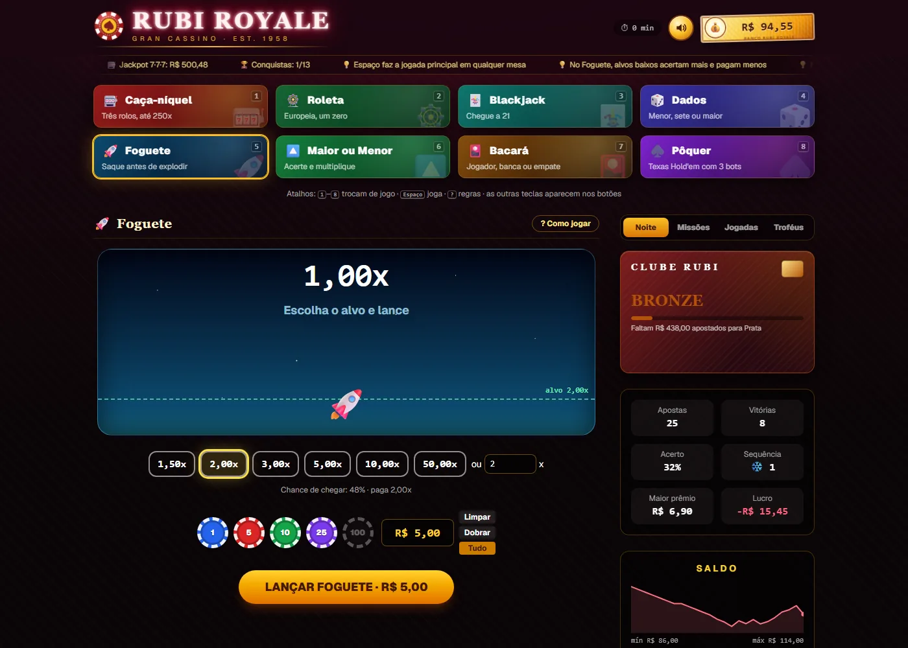
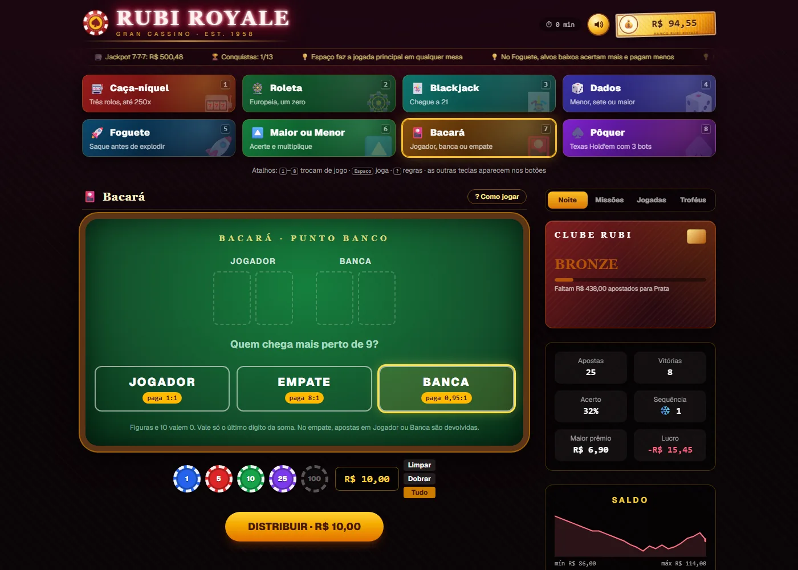
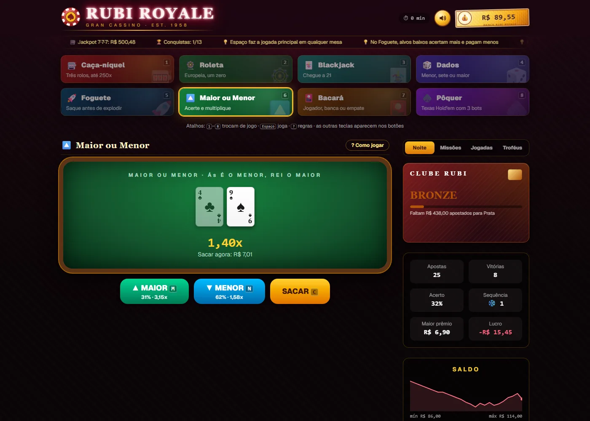
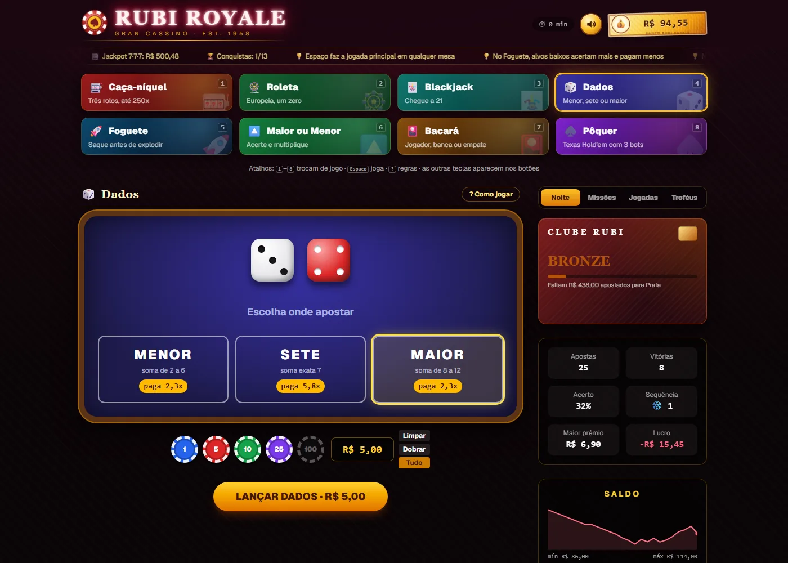
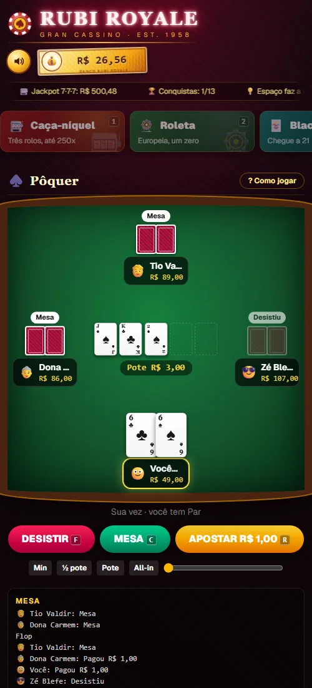

<div align="center">


# Rubi Royale · Gran Cassino

**Um cassino completo no navegador: oito mesas, missões, conquistas e um pôquer contra bots que pensam.**


[Jogos](#-os-jogos) · [Recursos](#-além-dos-jogos) · [Como rodar](#-como-rodar) · [API](#-api) · [Estrutura](#-estrutura)

<br />



</div>

> [!NOTE]
> Projeto de estudo, irmão do [Hipódromo Virtual](https://github.com/SamuelSchutz13/Hipodromo-Simulator). Todo o dinheiro do jogo é fictício: nada aqui envolve dinheiro de verdade.

---

## 🎲 Os jogos

<table>
  <tr>
    <td width="50%" valign="top">
      
      <h3>♠️ Pôquer · Texas Hold'em</h3>
      Mesa sem limite contra <b>3 bots com personalidade</b> (cautelosa, solta, agressiva) que avaliam a mão simulando 150 rodadas antes de decidir, e blefam. Blinds R$ 0,50 / R$ 1, desistir, mesa, pagar, aumentar e all-in, <b>side pots</b> e showdown. Você compra fichas (R$ 20 a R$ 200) e leva de volta ao sair.
    </td>
    <td width="50%" valign="top">
      
      <h3>🃏 Blackjack</h3>
      Mesa de feltro com sapato, carta da banca virada até o fim. Pedir, parar e dobrar. Blackjack paga 3:2 e a banca para em 17. Se você fechar a página no meio da mão, ela continua de onde parou.
    </td>
  </tr>
  <tr>
    <td valign="top">
      
      <h3>🎡 Roleta europeia</h3>
      Roda com os 37 números na ordem real e bola girando ao contrário. Espalhe fichas pela mesa: número (35:1), dúzia (2:1), cor, par/ímpar e metades (1:1). Desfazer, limpar e repetir aposta.
    </td>
    <td valign="top">
      
      <h3>🚀 Foguete</h3>
      Escolha um alvo de 1,01x a 100x e lance. Se o foguete passar do alvo antes de explodir, você ganha aposta × alvo. A tela mostra a chance exata de cada alvo; o retorno é de 96% em qualquer um.
    </td>
  </tr>
  <tr>
    <td valign="top">
      
      <h3>🎴 Bacará</h3>
      Punto Banco com a tabela oficial de terceira carta e cartas distribuídas uma a uma. Jogador 1:1, Banca 0,95:1, Empate 8:1.
    </td>
    <td valign="top">
      
      <h3>🔼 Maior ou Menor</h3>
      A próxima carta é maior ou menor? Cada acerto multiplica o prêmio (0,97 ÷ chance), e você saca quando quiser, ou arrisca mais uma.
    </td>
  </tr>
  <tr>
    <td valign="top">
      
      <h3>🎲 Dados</h3>
      Dois dados rolando no feltro azul. A soma vai ser menor que 7 (2,3x), exatamente 7 (5,8x) ou maior que 7 (2,3x)?
    </td>
    <td valign="top">
      <h3>🎰 Caça-níquel "Super 7"</h3>
      Gabinete com luzes, alavanca e 3 rolos (na imagem do topo). Trinca paga até <b>250x</b>, par nos dois primeiros rolos paga até 8x, e 7·7·7 ainda leva o <b>jackpot progressivo</b>, que começa em R$ 500 e cresce com 2% de cada giro. Retorno teórico de ~95%.
    </td>
  </tr>
</table>

> [!IMPORTANT]
> **O servidor decide tudo.** O navegador só anima um resultado que já chegou pronto. O baralho e as cartas dos bots nunca saem do servidor, então não dá pra trapacear pelo console.

## ✨ Além dos jogos

| | Recurso | |
| --- | --- | --- |
| 🏅 | **Missões diárias** | 3 por dia, sorteadas de 11, com prêmio de R$ 15 a R$ 30 |
| 🏆 | **13 conquistas** | Jackpot!, Na mosca, Astronauta, Mão de respeito, Magnata… com aviso ao desbloquear |
| 🎁 | **Presente do dia** | Surpresa de R$ 10 a R$ 500 uma vez por dia |
| 💳 | **Clube Rubi** | Cartão de fidelidade que sobe de Bronze a Diamante conforme você aposta |
| 📈 | **Sua noite** | Apostas, acerto, sequência, maior prêmio, lucro e gráfico do saldo |
| 🎉 | **Grande vitória** | Tela cheia com o prêmio subindo quando você ganha 10x ou mais |
| 📖 | **Como jogar** | Regras de cada mesa num clique (ou na tecla `?`) |
| ⌨️ | **Atalhos** | `1`–`8` trocam de jogo, `Espaço` joga, e cada mesa tem as suas teclas |
| ⏱️ | **Relógio da sessão** | Com um lembrete gentil de pausa a cada 30 minutos |
| 🔊 | **Sons sintetizados** | Fichas, cartas, dados e bola criados na hora com Web Audio, sem arquivos de áudio |
| 💾 | **Lembra de tudo** | Saldo, progresso, mãos em andamento e o valor apostado em cada jogo |

<details>
<summary><b>📱 No celular</b> (dá pra instalar como app)</summary>
<br />


O lobby vira uma faixa que você arrasta para o lado, as mesas se ajustam à tela e o site pode ser adicionado à tela inicial.
</details>

## 🚀 Como rodar

Você precisa de **Go 1.27+** e **Node.js 22+**.

```sh
git clone https://github.com/SamuelSchutz13/Cassino-Simulator.git
cd Cassino-Simulator/frontend
npm install
npm run build

cd ../backend
go run .
```

Abra **http://localhost:8081**. A porta é a 8081 para rodar junto com o Hipódromo (que usa a 8080); troque com a variável `PORT` se precisar. Dá pra abrir direto num jogo: `/#slots`, `/#roulette`, `/#blackjack`, `/#dice`, `/#crash`, `/#hilo`, `/#baccarat`, `/#poker`.

**Desenvolvendo o front:** deixe o `go run .` ligado e rode `npm run dev` em `frontend/`. O Vite repassa `/api` para a porta 8081.

## 🧠 API

| Método | Rota | Corpo |
| --- | --- | --- |
| `GET` | `/api/state` | Saldo, estatísticas, rodadas em andamento, missões e conquistas |
| `POST` | `/api/slots` | `{ amount }` |
| `POST` | `/api/roulette` | `{ bets: [{ kind, number, amount }] }`, `kind` = `numero`, `duzia`, `vermelho`, `preto`, `par`, `impar`, `baixo`, `alto` |
| `POST` | `/api/dice` | `{ amount, pick }`, `pick` = `menor`, `sete` ou `maior` |
| `POST` | `/api/crash` | `{ amount, target }`, `target` em centésimos (`250` = 2,50x) |
| `POST` | `/api/blackjack/deal` | `{ amount }` |
| `POST` | `/api/blackjack/hit` · `stand` · `double` | — |
| `POST` | `/api/baccarat` | `{ amount, pick }`, `pick` = `jogador`, `banca` ou `empate` |
| `POST` | `/api/hilo/start` · `guess` · `cashout` | `{ amount }` · `{ pick: "maior" \| "menor" }` · — |
| `POST` | `/api/poker/sit` · `rebuy` | `{ amount }` (fichas) |
| `POST` | `/api/poker/deal` · `leave` | — |
| `POST` | `/api/poker/act` | `{ action, amount }`, `action` = `fold`, `check`, `call` ou `raise` (`amount` = total da aposta na rodada) |
| `POST` | `/api/missions/claim` | `{ index }` (0 a 2) |
| `POST` | `/api/bonus` · `/api/reset` | — |

Valores em **centavos**. Toda resposta de jogada é `{ result, state }`.

## 📁 Estrutura

```
backend/
  main.go           servidor, saldo, histórico, presente, salvamento
  games.go          caça-níquel (com jackpot), roleta, dados e foguete
  blackjack.go      blackjack
  cards.go          maior ou menor e bacará
  poker.go          texas hold'em: avaliador de mãos, mesa, bots, side pots
  missions.go       missões diárias
  achievements.go   conquistas
  *_test.go         testes
frontend/src/
  App.tsx           lobby, cabeçalho, painel lateral
  components/       uma tela por jogo + fichas, quadro-negro e extras
  casino.css        o visual de cada mesa
  lib/              api e sons
docs/screenshots/   imagens deste README
```

## 🧪 Testes

```sh
cd backend
go test ./...
```

Os testes conferem o retorno teórico de cada jogo (caça-níquel, dados, foguete, bacará), as regras do blackjack e do bacará, o ranking das mãos de pôquer, os side pots e que **300 mãos de pôquer seguidas não criam nem somem com nenhuma ficha**.

## 💾 Salvamento

Saldo, estatísticas, missões, conquistas e rodadas em andamento ficam em `backend/save.json` (fora do git). Apague o arquivo para recomeçar do zero.
